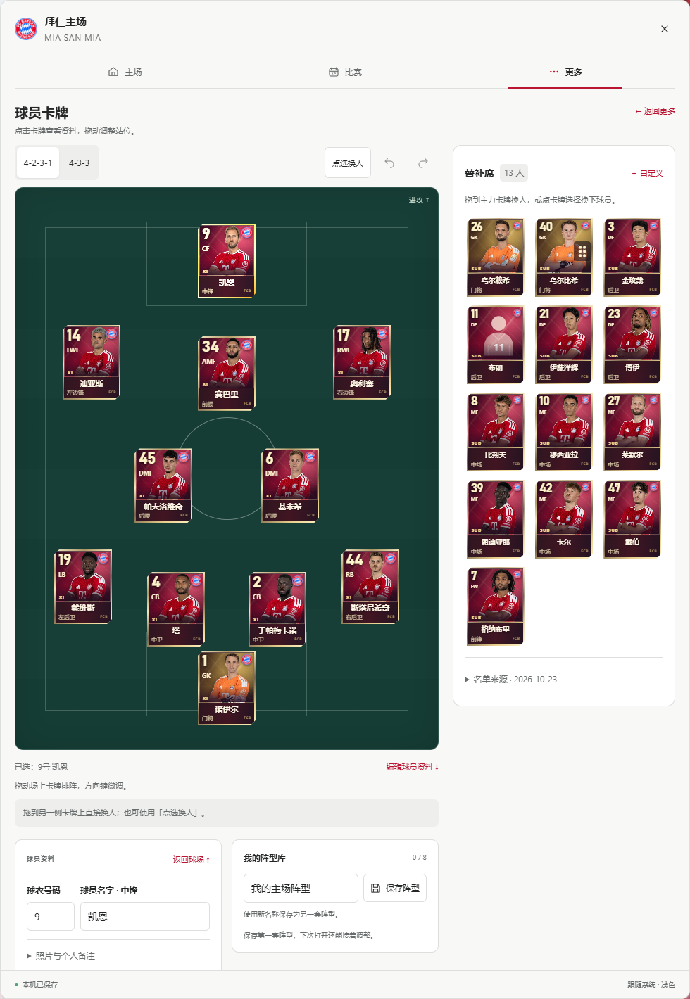
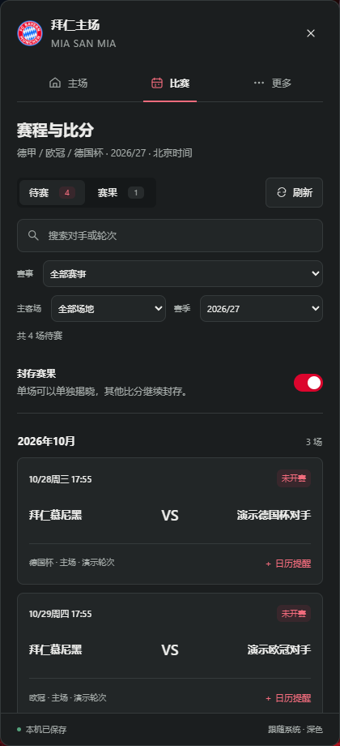
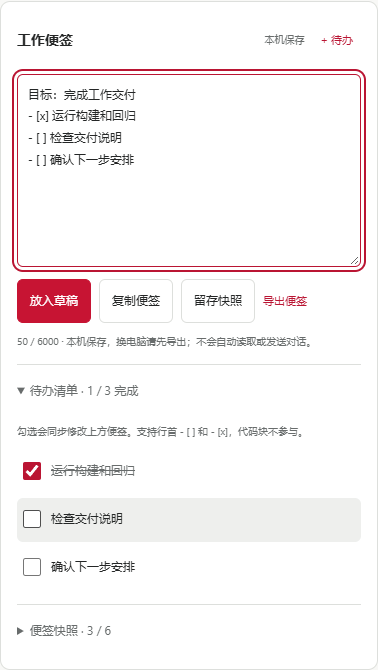

# 拜仁主场 · DeepSeek Harness 插件

非官方拜仁球迷主题，把赛程、球员卡牌阵型和工作助手放进 DSH。

**当前版本：0.18.0** · [下载最新版](https://github.com/Li-junning/plugin-dsh-2/releases/tag/v0.18.0) · [完整版本记录](CHANGELOG.md)


<details><summary>浅色界面</summary>



</details>

## 本次更新

- **三项赛事合并**：拜仁的德甲、欧冠和德国杯按开球时间排列，首页与迷你卡选择最近一场；比赛页可以按赛事、主客场和对手筛选。
- **比分与提醒**：默认封存比分，支持单场揭晓；加时与点球比分标明阶段。可导出带赛事名称的 ICS 日历，提前 15 / 30 / 60 / 120 分钟提醒。
- **分别同步与缓存**：一项赛事读取失败时保留其有效缓存，其他赛事继续更新，支持重试。缓存最长 30 天，兼容旧版德甲缓存。

后续淘汰赛随抽签和数据源更新，不生成尚未确定的对阵。OpenLigaDB 为社区数据，时间、状态与比分可能延迟，请以官方赛程为准。日历导入后不会自动同步改期。



## 从 0.5.2 升级后还有哪些功能

- **工作助手**：更多 → 工作助手。便签自动保存，可复制、追加到当前草稿或导出 Markdown；支持待办勾选、最近 6 份快照、恢复前留存和完整 JSON 备份。
- **我的常用指令**：最多 8 条个人指令，支持新建、编辑、模板复制、撤销移除和编辑稿暂存。内置理清需求、检查改动、交接进度模板；附带便签须主动勾选，写入草稿后由用户自行发送。
- **球员卡牌与替补换人**：可编辑的 4-2-3-1 / 4-3-3 卡牌阵型，宽屏左侧球场、右侧替补席。支持双向拖拽换人、点选换人、触屏和键盘操作，保留场上站位并支持撤销/重做。
- **球员资料与阵型库**：可自定义姓名、号码、照片和备注，保存阵型、导出 PNG、备份与恢复。参考首发与替补资料附来源和核对日期，均不代表实时比赛名单。
- **球迷名片**：编辑个人球迷名片并导出 PNG。
- **界面与布局**：主场 / 比赛 / 更多三个入口；隐藏式工具栏、可关闭迷你卡、深浅主题、专注阅读、工具顺序和面板宽度设置。搜索与筛选在本次面板内切页保留，关闭后重置并重新封存比分。
- **输入与恢复保护**：支持中文输入法、Unicode 字数计数、超长粘贴保护、复制失败时手动选取、存储失败重试，以及恢复备份前预览与确认。

[查看主力与替补双向换人演示](docs/demos/card-exchange.webm)（0.14.0 操作录屏，展示当前仍支持的换人操作；来自隔离预览）。旧版传球、跑位和演练界面已在 0.12.0 移除。



## 安装与更新

1. 从 [v0.18.0 Release](https://github.com/Li-junning/plugin-dsh-2/releases/tag/v0.18.0) 下载 `dsh-bayern-home-0.18.0-windows.zip`，完整解压。
2. 保存工作并完整退出 DeepSeek Harness。
3. 双击 `安装插件.cmd`。找不到宿主时，按提示输入 `DeepSeek Harness.exe` 所在文件夹。
4. 重新打开 DSH，鼠标移到右侧细红条打开工具。

插件不包含 DSH 主程序。更多安装、卸载和本地 tgz 用法见 [INSTALL.md](INSTALL.md)。

若 `dsh` 已在 PATH 中，也可以执行：

```powershell
dsh plugin --profile desktop add "github:Li-junning/plugin-dsh-2#v0.18.0" --ignore-scripts
```

桌面版随附 CLI 位于安装目录的 `resources/runtime/cli/bin/dsh.cmd`。仓库包含预构建 `lib/`，安装不需要自行编译，也不需要额外足球 API Key。`private: true` 用于避免误发布到 npm，不影响 GitHub 或 tgz 安装。

## 数据与兼容性

- 赛程通过 OpenLigaDB 联网读取。启用迷你卡时，面板或迷你卡可见期间每分钟尝试更新；支持北京时间和慕尼黑时间，自动换算德国夏令时。
- 背景与球员照片内嵌，阵型、设置、名片、工作便签及缓存保存在本机。不传送 DSH 对话、模型密钥或账号信息，不自动发送消息。
- 首发参考为 2026-10-10 对奥格斯堡的官方名单；替补资料于 2026-10-23 核对。来源见 `src/lineup.json` 与 `src/reserves.json`。
- 0.18.0 已通过 **86 项单元测试、22 套 124 项界面检查**，覆盖深浅主题、320px 窄屏、离线恢复、旧数据迁移和分发包校验；三项赛事真实公开接口响应也已验证。
- 既有安装脚本曾验证 DSH 0.2.0-rc.2；本机 DSH 0.2.1-rc.2 的开发链接已核对。0.18.0 尚未重新进行真实宿主冷启动验收，其他宿主版本未验证。

截图与演示用于说明界面；测试画面中的示例比赛不代表实时赛程或结果。

## 开发与预览

Node.js 20 或更新版本：

```sh
npm test
npm run build
npm run pack
npm run verify:ui
```

插件没有 npm 运行依赖，构建和单元测试无需 `npm install`。UI 检查使用 Playwright 与 Chromium/Edge，可通过 `DSH_PLAYWRIGHT_MODULE` 和 `DSH_BROWSER_PATH` 指定现有安装。

双击 `打开预览.cmd` 或执行 `npm run preview` 查看本地界面。预览外壳模拟 DSH，发送预览消息不会调用模型。构建、打包和发布规则见 [PUBLISH.md](PUBLISH.md)。

## 许可与来源

代码采用 [MIT License](LICENSE)。本项目为非官方球迷作品，拜仁名称、队徽、球员照片及其他商标归相应权利人；代码许可不授予这些素材的权利。背景由 AI 创作。完整说明见 [NOTICE.md](NOTICE.md)。

参考：[DSH 发布文档](https://deepseek-harness.github.io/deepseek-harness/en/develop/basic/publish)、[DSH Slots](https://deepseek-harness.github.io/deepseek-harness/en/reference/subsystems/slots)、[OpenLigaDB](https://api.openligadb.de/index.html)。
