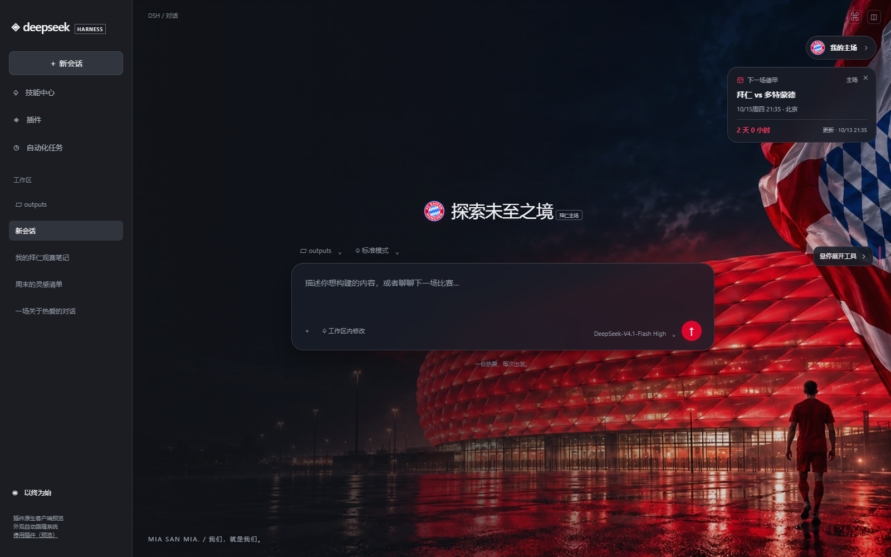
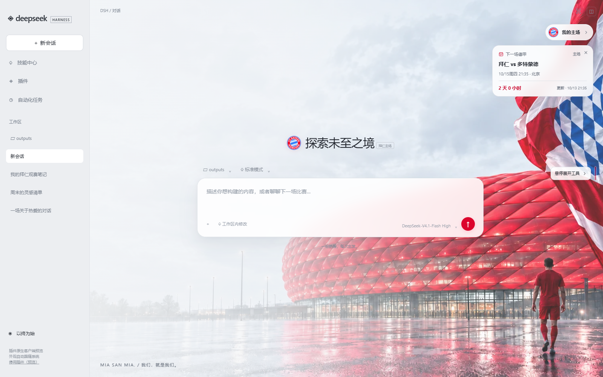
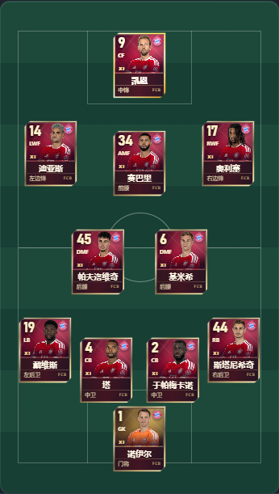

# 拜仁主场 · DeepSeek Harness 插件

让每一次对话，都像回到主场。非官方拜仁球迷主题，为 DSH 带来安联球场、队旗与球员背景，以及赛程、比分和战术工具。

**当前版本：0.5.2** · 面向 Windows / DeepSeek Harness Desktop **0.2.0-rc.2**；已验证本版分发包离线安装、界面交互与深浅主题。其他 DSH 版本尚未验证。



<details><summary>查看浅色版：同一构图，不同光线</summary>



</details>

## 0.5.2 更新

- 修复旧战术板保留空白球员卡的问题。即使已经拖动、画路线或保存阵型，空白卡片也会自动补入内置参考球员姓名、号码和照片。
- 保留当前阵型、坐标、路线、自定义姓名、号码、备注和照片；补全结果自动保存，阵型库中的旧空白卡片也会补齐。

## 0.5.1 更新

- 球员卡加入实况足球卡片风格的红金金属边框、切角、光纹与左侧位置标识；大号数字继续使用真实球衣号码。
- 点选球员后展示同款大卡，保留照片、资料编辑与站位拖动。深浅主题使用一致的红金卡面，两套阵型适配窄窗口。
- 卡面为插件原创样式，不包含游戏卡面素材或游戏能力评分。

## 0.5.0 更新

- **11 张首发球员名片**：球场上的每个位置改为照片、真实号码、姓名和位置组成的个人卡片；选中后显示更大的个人名片和英文全名，可编辑名字、号码与个人备注。
- **真实参考阵容**：内置 2026-10-10 对奥格斯堡的拜仁官方 4-2-3-1 首发，照片来自德甲官方球员页；名单标明日期和来源，可一键载入并撤销。新建或未编辑的空白战术板自动使用这套参考；已编辑阵型继续保留。
- **照片随插件提供**：11 张照片嵌入客户端，离线也可显示；支持自行换照片、移除、自动压缩和本机保存。切换阵型、保存阵型时保留球员资料；传入对话的是文字站位和备注。
- **适配窄窗口**：两套阵型均检查了卡片边界和重叠，拖动及方向键移动限制在球场内。参考名单不是实时首发，卡片位置可自由调整。



## 0.4.0 更新

- **可编辑战术板**：拖动 11 名球员、填写名字和号码；拖拽或点击两点画传球线，支持方向键微调、撤销和删除路线。保存最多 8 套自定义阵型；切换 4-2-3-1 / 4-3-3 时保留命名。把当前站位和路线追加到 DSH 未发送草稿。
- **个人球迷名片**：自定义昵称、号码、主场标语；主场红 / 客场银两种样式，实时预览并导出 1200×750 PNG。全部在本机生成，不自动分享。
- **主场布局编辑**：调整工具顺序、迷你卡三个位置和 360–520px 面板宽度；提供简洁 / 比赛日布局，偏好即时生效并保存。
- **UI 精修**：六个带图标的页面入口、统一编辑卡片与表单层级；切换页面从顶部开始；「我的主场」入口移到原生工具栏下方，保留宿主右上角按钮。

最新安装包和源码可从 [GitHub Releases](https://github.com/Li-junning/plugin-dsh-2/releases/tag/v0.5.2) 下载。

## 0.3.0 更新

- 主场入口旁新增下一场德甲迷你卡，可关闭；聊天和专注阅读时自动收起。
- 快捷工具增加 180ms 悬停等待、固定开关和首次使用提示，继续支持触屏与键盘。
- 比赛按月份分组，显示明确状态；比分可单场揭晓、重新封存，关闭面板后自动重新封存。
- 赛程按赛季缓存在本机，最长 30 天；重开窗口先展示缓存并尝试更新，离线时标注缓存时间。
- 背景保留完整图片高度，始终贴右下；打开侧面板不再重新缩放背景。

预览中的比赛卡使用演示数据，不代表当前赛程或真实赛果。

## 下载与安装

### 直接下载安装包（Windows）

1. 从 [v0.5.2 Release](https://github.com/Li-junning/plugin-dsh-2/releases/tag/v0.5.2) 下载 `dsh-bayern-home-0.5.2-windows.zip`。
2. 解压到任意文件夹，保存工作并完整退出 DeepSeek Harness。
3. 双击 `安装插件.cmd`。脚本会尝试寻找 DSH；找不到时，按提示输入 **DeepSeek Harness.exe 所在文件夹**。
4. 安装完成后重新打开 DSH。鼠标移到右侧细红条展开工具，右上角「我的主场」打开完整面板。

需先安装 DeepSeek Harness；插件安装包不包含宿主应用。

### 从 GitHub 直接安装

如果 `dsh` 已在 PATH 中：

```powershell
dsh plugin --profile desktop add "github:Li-junning/plugin-dsh-2#v0.5.2" --ignore-scripts
```

也可以通过 DSH 桌面版随附的 CLI 安装：

```powershell
$harnessFolder = Read-Host "请输入 DeepSeek Harness.exe 所在文件夹"
$dsh = Join-Path $harnessFolder "resources\runtime\cli\bin\dsh.cmd"
& $dsh plugin --profile desktop add "github:Li-junning/plugin-dsh-2#v0.5.2" --ignore-scripts
```

`#v0.5.2` 固定发行版本；去掉标签可安装 main 分支。仓库根目录包含完整 `package.json`、`cordis.patch.yml` 和预构建 `lib/`，安装无需自行构建，也无需额外模型密钥或足球 API Key。

完整说明、离线 tgz 安装与卸载方法见 [INSTALL.md](INSTALL.md)。

## 外观与功能

- **同一主场，两种光线**：深浅主题自动跟随系统应用颜色模式。保留右侧队旗和一名红衣球员；球场门前的远处人群已去掉。
- **隐藏式工具栏**：平时只留细红条，短暂悬停后展开三个入口，移开后收起，可固定展开；不推动对话布局。支持 Tab 聚焦、Esc 收起和触屏点击。
- **玻璃质感界面**：统一线性图标、圆角、浮动面板与比赛卡片。输入框样式通过 DSH 的原生语义属性生效。
- **赛程与比分**：通过 OpenLigaDB 读取德甲赛程、比赛状态与数据源记录的比分；支持手动刷新、赛季切换、北京时间和慕尼黑时间。
- **封存赛果**：默认隐藏面板里的比分，可以逐场揭晓；关闭面板后单场比分重新封存。
- **比赛日历**：未来且时间已确认的比赛可导出 ICS，支持提前 15 / 30 / 60 / 120 分钟提醒，导入日历应用后生效。
- **战术灵感**：可拖拽编辑的 4-2-3-1 / 4-3-3 战术板，把球员名字、站位和路线追加到当前未发送草稿，由你配置的模型接着讨论；不会自动发送消息。
- **专注阅读**：一键隐藏背景；背景浓度、时区、提醒等偏好保存在本机。

内置赛程覆盖德甲，欧冠和德国杯可通过面板里的官方全赛事赛程查看。OpenLigaDB 是社区数据，比分可能延迟；开球时间已过不代表数据源确认正在直播。离线日历不会自动同步赛程改期。

## 隐私与兼容性

背景、样式和队徽均内嵌在正式客户端。启用迷你卡时会自动访问 OpenLigaDB；面板或迷你卡可见时每分钟尝试更新。赛程、更新时间、阵型、上传的球员照片、名片字段与布局偏好仅保存在本机，不包含对话内容。查看比赛时直接访问 OpenLigaDB，不传送 DSH 对话、模型密钥或账号信息。分发包不包含本机 profile、日志、缓存或账号数据。

本插件与 `dsh-bayern-boot` 拜仁启动动画插件分别安装。不会修改或自动停用其他插件；如宿主报告某个旧插件不兼容，请通过 DSH 插件管理器处理该旧插件。

## 预览与开发

下载仓库源码后，双击 `打开预览.cmd` 或打开 `tools/preview.html`。预览使用正式插件客户端，DSH 外壳为模拟布局；发送预览消息不会调用模型。离线预览中的 React / ReactDOM 仅用于演示，不属于正式插件运行依赖。

修改源码后，用 Node.js 20 或更新版本运行：

```sh
npm test
npm run build
npm run pack
```

本插件没有 npm 运行依赖；无需 `npm install` 即可执行以上构建与数据测试。也可执行 `npm run preview`，在终端显示的本地 URL 预览。

发布维护说明见 [PUBLISH.md](PUBLISH.md)。

## 许可与素材

代码采用 [MIT License](LICENSE)。拜仁名称及队徽归原权利人所有，本项目为非官方球迷作品，代码许可不授予俱乐部商标的权利。背景由 AI 创作，并非球场实拍。球员照片来自德甲官方球员页，不属于代码 MIT 许可范围；来源和核对日期记录在 `src/lineup.json`。第三方说明见 [NOTICE.md](NOTICE.md)。

参考：[DSH 官方打包安装文档](https://deepseek-harness.github.io/deepseek-harness/en/develop/basic/publish)、[DSH Slots](https://deepseek-harness.github.io/deepseek-harness/en/reference/subsystems/slots)、[OpenLigaDB](https://github.com/OpenLigaDB/OpenLigaDB-Samples)。
